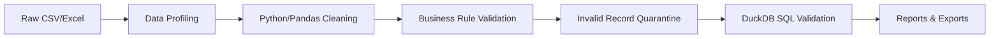

# Sales Data Cleaning & Automation

A reproducible, command-line data cleaning pipeline that turns messy e-commerce sales CSV/Excel exports into validated, analytics-ready datasets.

## Problem

E-commerce stores often collect sales data from multiple sources that contain:

- Duplicate order lines
- Missing or malformed dates
- Invalid quantities and prices
- Inconsistent categories, payment methods, and country names
- Bad customer emails
- Canceled and refunded orders mixed into revenue totals

Manual cleanup is slow, error-prone, and impossible to audit.

## Goals

- Provide a reusable, one-command pipeline that cleans raw sales data.
- Preserve the original data and quarantine bad records with explicit reasons.
- Validate the cleaned result with independent DuckDB/SQL checks.
- Generate stakeholder-ready quality and analytics reports.
- Maintain high test coverage and CI so the project is portfolio-ready.

## Tech Stack

- Python 3.12+
- Pandas — data cleaning and transformations
- DuckDB — SQL validation and analytics
- openpyxl — Excel exports
- pytest + pytest-cov — testing and coverage
- ruff + mypy — linting and type checking
- GitHub Actions — continuous integration

## Quick Start

```bash
python -m venv venv
source venv/bin/activate
pip install -r requirements-dev.txt

# Run the entire pipeline
python -m src.cli run-all --seed 42
```

## Pipeline



## CLI Usage

```bash
# Generate synthetic raw data
python -m src.cli generate

# Profile raw data
python -m src.cli profile

# Clean and quarantine records
python -m src.cli clean

# Run DuckDB validation and analytics
python -m src.cli validate

# Generate Markdown/JSON/CSV reports
python -m src.cli report

# Run everything
python -m src.cli run-all --seed 42
```

## Project Structure

```text
sales-data-cleaning-automation/
├── src/              # Python cleaning scripts
├── data/             # Raw, processed, and quarantine data
├── sql/              # DuckDB validation and analytics queries
├── tests/            # pytest suite
├── reports/          # Quality reports, analytics, and logs
└── docs/             # Documentation and screenshots
```

## Outputs

| File | Description |
|------|-------------|
| `data/raw/raw_sales.csv` | Synthetic source data with injected defects |
| `data/processed/cleaned_sales.csv` | Valid, analytics-ready records |
| `data/processed/cleaned_sales.xlsx` | Excel version of cleaned data |
| `data/quarantine/quarantined_sales.csv` | Records that could not be safely repaired, with reasons |
| `data/quarantine/quarantined_sales.xlsx` | Excel version of quarantined data |
| `reports/data_quality_report.md` | Human-readable quality summary |
| `reports/data_quality_report.json` | Machine-readable quality summary |
| `reports/summary_metrics.csv` | Key business metrics |
| `reports/pipeline.log` | Pipeline execution log |

## Testing

```bash
# Run the full test suite with coverage
pytest

# Lint and type check
ruff check .
mypy src tests
```

## Business Value

This project demonstrates a commercial data-cleaning service:

- **Auditability:** Every quarantined record has a clear reason.
- **Reproducibility:** Fixed random seed and version-pinned dependencies.
- **Independence:** DuckDB SQL checks catch mistakes in Python logic.
- **Actionable outputs:** Stakeholders receive cleaned files, a quarantine file, and a quality report.

## Portfolio & Freelancing

- **LinkedIn pitch:** "I built a reproducible sales data-cleaning pipeline in Python + DuckDB. It handles duplicates, bad dates, invalid prices, and quarantines bad records — all with full pytest coverage and GitHub Actions CI."
- **Fiverr/Upwork deliverable:** A fixed-price "Data Quality Health Check + Cleaning Automation" with cleaned CSV/Excel, quarantine file, quality report, and reusable source code.

## Screenshots

See [docs/screenshots/](docs/screenshots/) for before/after visuals, CLI output, and report examples.

Regenerate them after running the pipeline:

```bash
python -m src.cli run-all --seed 42
python scripts/generate_screenshots.py
```

## Documentation

- [Implementation Plan](docs/implementation-plan.md)
- [Freelance Pitch](docs/freelance-pitch.md)

## License

MIT
