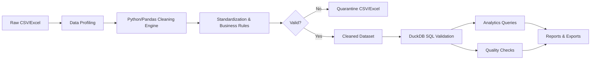
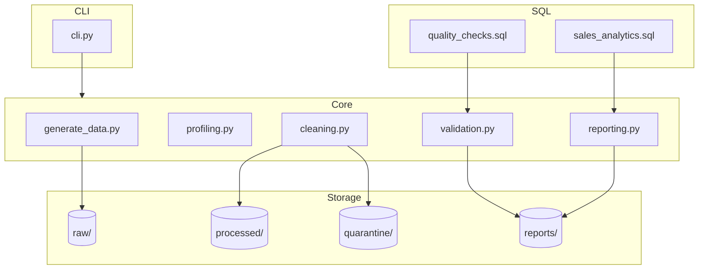

# Sales Data Cleaning & Automation — Implementation Plan

## 1. Executive Project Summary

Build a reproducible, command-line data-cleaning pipeline that turns messy e-commerce sales CSV/Excel files into validated, analytics-ready datasets. The project demonstrates enterprise-grade data-engineering practices: modular Python, DuckDB/SQL validation, comprehensive pytest coverage, GitHub Actions CI, and professional documentation. It is designed as both a learning project and a commercial portfolio piece that can be pitched to freelance clients.

**Scope:** MVP command-line tool plus synthetic dataset, SQL validation suite, quality reports, and automated tests. Optional UI/cloud deployment is explicitly out of scope for this version.

## 2. Business Problem and Goals

**Business Problem:**
An e-commerce company accumulates sales transactions from multiple sources (CSV/Excel exports). Records contain duplicates, missing customer/product details, malformed dates, invalid prices/quantities, inconsistent categories, bad emails, and ambiguous order statuses. Manual cleanup is error-prone and not reproducible.

**Goals:**
- Deliver a reusable Python cleaning engine that handles all common defects.
- Preserve originals and quarantine bad records for manual review.
- Validate cleaned data with independent DuckDB/SQL checks.
- Generate business-quality analytics and data-quality reports.
- Make the pipeline idempotent, configurable, and CI-tested.
- Package the work as a portfolio/freelance demonstration.

## 3. Technical Architecture





## 4. Complete Repository Structure

```text
sales-data-cleaning-automation/
├── .github/
│   └── workflows/
│       └── ci.yml                # GitHub Actions: lint, test, pipeline run
├── data/
│   ├── raw/
│   │   └── raw_sales.csv         # generated synthetic source data
│   ├── processed/
│   │   ├── cleaned_sales.csv
│   │   └── cleaned_sales.xlsx
│   └── quarantine/
│       ├── quarantined_sales.csv
│       └── quarantined_sales.xlsx
├── docs/
│   ├── implementation-plan.md    # this plan
│   └── screenshots/              # before/after outputs
├── reports/
│   ├── data_quality_report.md
│   ├── data_quality_report.json
│   └── summary_metrics.csv
├── sql/
│   ├── quality_checks.sql        # DuckDB validation queries
│   └── sales_analytics.sql       # business analytics queries
├── src/
│   ├── __init__.py
│   ├── generate_data.py          # synthetic dataset generator
│   ├── profiling.py              # data profiling / initial quality metrics
│   ├── cleaning.py               # cleaning functions and pipeline orchestration
│   ├── validation.py             # DuckDB/SQL validation wrapper
│   ├── reporting.py              # markdown/json/csv report generation
│   └── cli.py                    # argparse entry point
├── tests/
│   ├── __init__.py
│   ├── conftest.py               # fixtures, paths, seed
│   ├── test_generate_data.py
│   ├── test_cleaning.py
│   ├── test_validation.py
│   ├── test_reporting.py
│   └── test_integration.py       # end-to-end idempotency test
├── .gitignore
├── README.md
├── pyproject.toml                # project metadata, tool config (ruff, pytest, mypy)
├── requirements.txt
└── requirements-dev.txt
```

## 5. Dataset Schema and Synthetic Defect Strategy

### 5.1 Grain and Keys

- **Grain:** Each row represents one **order line** (a product within an order). A single `order_id` can appear on multiple rows.
- **Natural business key:** `order_id` + `product_id` + `order_date`.
- **Surrogate key:** A stable `row_id` generated from the hash of selected source fields or a UUID assigned at generation time. This lets us track every row from raw → clean/quarantine → report.

### 5.2 Columns

| Column | Type | Description |
|--------|------|-------------|
| `row_id` | string | Surrogate key, stable per record |
| `order_id` | string | Order identifier; may be missing or duplicated |
| `order_date` | string/DateTime | Transaction date; may be malformed |
| `customer_id` | string | Customer identifier |
| `customer_name` | string | May have extra whitespace, mixed case, special chars |
| `customer_email` | string | May be malformed/missing |
| `product_id` | string | Product SKU/code |
| `product_name` | string | May have inconsistent whitespace/case |
| `category` | string | Inconsistent category labels |
| `quantity` | int | May be negative, zero, or non-numeric |
| `unit_price` | float | May be negative/zero/non-numeric |
| `discount` | float | 0.0–1.0 decimal; may be percent, negative, or >1 |
| `payment_method` | string | Inconsistent labels (e.g., “cc”, “credit card”) |
| `country` | string | Inconsistent country names/codes |
| `order_status` | string | e.g., completed, canceled, refunded, pending |
| `total_amount` | float | Calculated: `quantity * unit_price * (1 - discount)` |

### 5.3 Defect Injection Strategy

Use `Faker` + `numpy.random.default_rng(seed=42)` for reproducibility. Target ~7,500 rows total with the following defect mix:

| Defect Category | Approximate Count | Injection Rule |
|-----------------|-------------------|----------------|
| Duplicate order lines | ~150 | Copy existing rows and slightly vary one non-key field |
| Missing `order_id` | ~100 | Blank or NULL |
| Invalid/missing dates | ~120 | Random strings, future dates, or empty |
| Invalid quantities | ~80 | Negative, zero, or text values |
| Invalid unit prices | ~80 | Negative, zero, or text |
| Malformed emails | ~150 | Missing @, bad domains, or blank |
| Inconsistent categories | ~200 | Random casing/abbreviations/typos |
| Inconsistent payment methods | ~150 | Alternate spellings/abbreviations |
| Missing customer or product names | ~100 | Blank or placeholder values |
| Bad discount values | ~60 | Negative, >1, or percentage strings |
| Canceled/refunded rows | ~200 | Realistic status values to validate business rules |
| Inconsistent country names | ~100 | Alternate spellings, uppercase, codes |

Total injected defects are documented in the generation script so report counts can be reconciled.

## 6. Detailed Data Cleaning Rules and Quarantine Policy

### 6.1 Cleaning Functions

| # | Function | Rule |
|---|----------|------|
| 1 | **Remove exact duplicates** | Drop duplicate business keys (`order_id`, `product_id`, `order_date`), keeping the first occurrence. Log count. |
| 2 | **Standardize dates** | Parse with `pd.to_datetime(errors='coerce')`. Accept formats: `%Y-%m-%d`, `%d/%m/%Y`, `%m/%d/%Y`. Reject future dates > today and dates before a sensible cutoff (e.g., 2010-01-01). |
| 3 | **Normalize names** | Strip leading/trailing whitespace, collapse multiple spaces, title-case customer/product names, remove non-printable chars. |
| 4 | **Trim whitespace** | Apply `str.strip()` and regex whitespace collapse to all string columns. |
| 5 | **Standardize categories** | Map known typos/abbreviations to canonical list: `Electronics`, `Clothing`, `Home & Garden`, `Sports`, `Books`, `Beauty`, `Toys`, `Food & Beverage`. Unknown values are flagged, not guessed. |
| 6 | **Safe numeric conversion** | Convert `quantity` to `Int64`, `unit_price`/`discount` to `Float64` with `errors='coerce'`. |
| 7 | **Validate quantities and prices** | `quantity` > 0, `unit_price` > 0. Rows failing this are quarantined. |
| 8 | **Handle missing values** | Missing `customer_name`/`product_name` are allowed if email/id present; missing `order_id` or key business fields trigger quarantine. |
| 9 | **Validate emails** | Use a permissive regex; invalid emails are stored but flagged in quality report. Missing emails are not invented. |
| 10 | **Identify invalid business records** | Apply business rule validation; invalid rows go to quarantine with reason. |
| 11 | **Record changes and metrics** | Every cleaning step appends to an in-memory log with before/after counts and reason codes. |
| 12 | **Quarantine unrepairable records** | Rows that cannot be safely repaired (negative price, missing key identifiers, unparseable date, etc.) are written to quarantine. |

### 6.2 Business Rules

- **Discounts:** Must be numeric, between `0.0` and `0.80` (max 80% discount). Convert percentage strings like `20%` to `0.20`. Values outside range are capped to nearest valid boundary or quarantined if nonsensical.
- **Currency:** All monetary values are USD, two decimals after rounding.
- **Canceled/Refunded Orders:** Retained in cleaned set; add `is_revenue_realized` flag (`True` for completed, `False` for canceled/refunded). Analytics reports both gross and net-realized revenue.
- **Sales Calculation:** `total_amount = round(quantity * unit_price * (1 - discount), 2)`.
- **Payment Method Normalization:** Map variants to `Credit Card`, `PayPal`, `Bank Transfer`, `Cash`, `Crypto`, `Other`.
- **Country Normalization:** Use `pycountry` to map common names and ISO codes to canonical English names.

### 6.3 Quarantine Policy

Records are quarantined when any of the following are true:
- Missing `order_id` **and** cannot be safely assigned a placeholder (use a generated placeholder only if `customer_id` and `order_date` exist; still flag).
- Unparseable `order_date` or date outside valid range.
- `quantity` <= 0 or non-numeric.
- `unit_price` <= 0 or non-numeric.
- `discount` < 0 or > 1 after conversion (cannot be salvaged).
- Duplicate business key after the first occurrence.
- Both `customer_email` and `customer_name` missing (cannot identify customer).

Quarantined records include a `quarantine_reason` column. They are never silently removed, and no customer data is fabricated.

## 7. SQL Validation Strategy

All SQL runs inside DuckDB using the cleaned CSV as an external table or loaded table.

### 7.1 Quality Checks (`sql/quality_checks.sql`)

| Check | SQL Approach |
|-------|--------------|
| Total valid records | `SELECT COUNT(*) FROM cleaned_sales` |
| Duplicate detection | `GROUP BY order_id, product_id, order_date HAVING COUNT(*) > 1` |
| Missing-value checks | `SELECT column, COUNT(*) - COUNT(column) AS missing FROM cleaned_sales` |
| Invalid quantity/price | `SELECT * WHERE quantity <= 0 OR unit_price <= 0` |
| Invalid discount | `WHERE discount < 0 OR discount > 0.80` |
| Bad email format | Regex `WHERE customer_email NOT LIKE '%@%.%'` |
| Date range check | `WHERE order_date < '2010-01-01' OR order_date > CURRENT_DATE` |
| Status consistency | `WHERE order_status NOT IN ('completed','canceled','refunded','pending')` |

### 7.2 Analytics Queries (`sql/sales_analytics.sql`)

- Total valid records
- Total sales (gross and realized)
- Monthly sales trends
- Revenue by product category
- Revenue by country
- Top 10 selling products by quantity and revenue
- Average order value (AOV)
- Discount distribution

### 7.3 Independence from Pandas

The SQL layer re-runs the same quality rules using DuckDB. If Pandas cleaning has a bug (e.g., failing to coerce negative quantities), SQL checks will detect remaining invalid records. This two-layer validation increases confidence.

## 8. Phased Implementation Roadmap

### Milestone 1 — Project Setup and Architecture

- **Purpose:** Establish a clean, reproducible project skeleton and tooling.
- **Tasks:**
  1. Initialize Python project with `pyproject.toml`.
  2. Add `.gitignore` (Python/IDE/data artifacts).
  3. Create folder structure from Section 4.
  4. Pin dependencies in `requirements.txt` and `requirements-dev.txt`.
  5. Configure `ruff`, `pytest`, and `mypy` in `pyproject.toml`.
  6. Write initial `README.md` outline.
- **Files to create:**
  - `pyproject.toml`
  - `.gitignore`
  - `README.md`
  - `requirements.txt`
  - `requirements-dev.txt`
  - folder tree
- **Dependencies:** Python 3.12+, `pandas`, `duckdb`, `openpyxl`, `faker`, `pycountry`
- **Estimated effort:** 1 session
- **Testing and verification:**
  - `python --version` >= 3.12
  - `pip install -r requirements.txt` succeeds
  - `pytest` runs (no tests yet, exits successfully)
  - `ruff check .` and `mypy src` pass on empty project
- **Definition of Done:** Project scaffold builds and passes CI lint stage.

### Milestone 2 — Dataset Generation and Profiling

- **Purpose:** Generate reproducible synthetic data and understand its quality before cleaning.
- **Tasks:**
  1. Implement `src/generate_data.py` with Faker and fixed RNG seed.
  2. Define schema as dataclass or TypedDict.
  3. Inject defects per Section 5.3 with explicit counters.
  4. Write `src/profiling.py` to compute nulls, duplicates, min/max, top categories.
  5. Save `data/raw/raw_sales.csv` and a profiling JSON.
- **Files to create:**
  - `src/generate_data.py`
  - `src/profiling.py`
  - `data/raw/raw_sales.csv`
  - `reports/profiling_snapshot.json`
- **Dependencies:** `faker`, `pandas`
- **Estimated effort:** 1 session
- **Testing and verification:**
  - Generated row count in expected range.
  - Defect counts match injection rules within ±5%.
  - Profiling report correctly flags expected nulls/duplicates.
  - Re-running with same seed produces identical file (byte-level check of sorted content or hash).
- **Definition of Done:** Synthetic data exists, profiling report is generated, and generation is deterministic.

### Milestone 3 — Python Data Cleaning Engine

- **Purpose:** Implement the cleaning functions and quarantine logic.
- **Tasks:**
  1. Implement cleaning functions in `src/cleaning.py` (one function per rule from Section 6).
  2. Add business-rule validation and `quarantine_reason` tagging.
  3. Build a pipeline function that returns `(clean_df, quarantine_df, log_df)`.
  4. Persist `cleaned_sales.csv`, `cleaned_sales.xlsx`, `quarantined_sales.csv`, `quarantined_sales.xlsx`.
- **Files to create:**
  - `src/cleaning.py`
  - `data/processed/cleaned_sales.csv`
  - `data/processed/cleaned_sales.xlsx`
  - `data/quarantine/quarantined_sales.csv`
  - `data/quarantine/quarantined_sales.xlsx`
- **Dependencies:** `pandas`, `openpyxl`, `pycountry`
- **Estimated effort:** 2 sessions
- **Testing and verification:**
  - Unit tests for each cleaning function.
  - Record count reconciliation: `len(raw) == len(clean) + len(quarantine)`.
  - No negative quantities/prices remain in cleaned data.
  - Quarantine file contains a non-empty `quarantine_reason` for every row.
- **Definition of Done:** Cleaning module passes all unit tests and produces reconciled outputs.

### Milestone 4 — SQL Validation and Analytics

- **Purpose:** Add independent DuckDB validation and analytics queries.
- **Tasks:**
  1. Write `sql/quality_checks.sql`.
  2. Write `sql/sales_analytics.sql`.
  3. Implement `src/validation.py` to execute SQL files and return DataFrames.
  4. Implement `src/reporting.py` to generate Markdown/JSON/CSV reports from validation results.
- **Files to create:**
  - `sql/quality_checks.sql`
  - `sql/sales_analytics.sql`
  - `src/validation.py`
  - `src/reporting.py`
  - `reports/data_quality_report.md`
  - `reports/data_quality_report.json`
  - `reports/summary_metrics.csv`
- **Dependencies:** `duckdb`
- **Estimated effort:** 1–2 sessions
- **Testing and verification:**
  - All SQL quality checks pass on cleaned data.
  - Analytics query results match independent Pandas calculations within rounding error.
  - Report totals reconcile with cleaned record counts.
- **Definition of Done:** SQL validation suite runs cleanly and generates all three report formats.

### Milestone 5 — Automation and Reporting

- **Purpose:** Wrap the pipeline in a CLI and automate the full workflow.
- **Tasks:**
  1. Implement `src/cli.py` using `argparse`.
  2. Support commands: `generate`, `profile`, `clean`, `validate`, `run-all`.
  3. Add configurable input/output paths via CLI arguments and optional config file.
  4. Add `logging` with levels, rotating to `reports/pipeline.log`.
  5. Ensure idempotency: re-running produces identical outputs given the same inputs.
- **Files to create:**
  - `src/cli.py`
  - `reports/pipeline.log` (generated at runtime)
- **Dependencies:** `argparse`, `logging`
- **Estimated effort:** 1 session
- **Testing and verification:**
  - `python -m src.cli --help` works.
  - `python -m src.cli run-all --seed 42` completes end-to-end.
  - Re-running `run-all` overwrites prior outputs deterministically.
- **Definition of Done:** Single CLI command runs the entire pipeline and produces all deliverables.

### Milestone 6 — Testing and Quality Assurance

- **Purpose:** Guarantee correctness, reproducibility, and idempotency.
- **Tasks:**
  1. Write unit tests for every public function.
  2. Write integration test for the full pipeline.
  3. Write idempotency test (run twice, compare hashes).
  4. Add fixtures and parameterized edge cases in `tests/conftest.py`.
  5. Wire GitHub Actions `.github/workflows/ci.yml`.
- **Files to create:**
  - `tests/conftest.py`
  - `tests/test_generate_data.py`
  - `tests/test_cleaning.py`
  - `tests/test_validation.py`
  - `tests/test_reporting.py`
  - `tests/test_integration.py`
  - `.github/workflows/ci.yml`
- **Dependencies:** `pytest`, `pytest-cov`
- **Estimated effort:** 1–2 sessions
- **Testing and verification:**
  - `pytest` achieves >= 90% code coverage.
  - CI passes on Python 3.12.
  - Idempotency test passes.
- **Definition of Done:** All tests pass in CI and locally with high coverage.

### Milestone 7 — Portfolio and GitHub Publication

- **Purpose:** Polish the project for public and client-facing use.
- **Tasks:**
  1. Finalize `README.md` with architecture diagram, usage examples, and screenshots.
  2. Capture before/after screenshots into `docs/screenshots/`.
  3. Add `docs/freelance-pitch.md`.
  4. Verify GitHub Actions badge.
  5. Tag a v0.1.0 release.
- **Files to create:**
  - `docs/screenshots/*.png`
  - `docs/freelance-pitch.md`
- **Dependencies:** None
- **Estimated effort:** 1 session
- **Testing and verification:**
  - README renders correctly on GitHub.
  - CI badge is green.
  - Screenshots show raw vs cleaned data and reports.
- **Definition of Done:** Repository is public-ready and demonstrates commercial value.

## 9. Test Cases and Acceptance Criteria

### 9.1 Unit Tests

| Module | Test Case |
|--------|-----------|
| `generate_data.py` | Fixed seed produces identical row counts and defect counts. |
| `cleaning.py` | `standardize_dates` converts known formats and coerces invalid dates to `NaT`. |
| `cleaning.py` | `normalize_names` trims whitespace and title-cases strings. |
| `cleaning.py` | `normalize_categories` maps typos to canonical labels. |
| `cleaning.py` | `convert_numeric_columns` coerces invalid strings to `NaN`. |
| `cleaning.py` | `validate_business_rules` quarantines negative quantities/prices. |
| `cleaning.py` | Dedupe reduces duplicate business keys to one. |
| `validation.py` | DuckDB quality checks return zero issues on a clean fixture. |
| `reporting.py` | Markdown report contains expected sections and counts. |

### 9.2 Integration & Acceptance

- **E2E Pipeline:** Running the CLI from raw data produces `cleaned_sales.csv`, `quarantined_sales.csv`, quality reports, and `summary_metrics.csv`.
- **Reconciliation:** `raw_count == clean_count + quarantine_count`.
- **Idempotency:** Re-running the pipeline twice yields identical report hashes.
- **CI:** All tests pass on `ubuntu-latest` with Python 3.12.
- **Quality Gate:** No high-severity lint issues; type hints pass `mypy --strict`.

## 10. Deliverables Checklist

- [ ] `data/raw/raw_sales.csv`
- [ ] `data/processed/cleaned_sales.csv`
- [ ] `data/processed/cleaned_sales.xlsx`
- [ ] `data/quarantine/quarantined_sales.csv`
- [ ] `data/quarantine/quarantined_sales.xlsx`
- [ ] `reports/data_quality_report.md`
- [ ] `reports/data_quality_report.json`
- [ ] `reports/summary_metrics.csv`
- [ ] `src/*.py` reusable scripts
- [ ] `sql/quality_checks.sql` and `sql/sales_analytics.sql`
- [ ] `tests/` with pytest suite
- [ ] `README.md`
- [ ] `docs/screenshots/` before/after images
- [ ] `.github/workflows/ci.yml`

## 11. Risks and Assumptions

| Risk | Mitigation |
|------|------------|
| Synthetic data is too clean or unrealistic | Inject varied real-world defects; review sample rows manually. |
| Pandas cleaning logic hides bugs from SQL layer | Keep SQL validation independent and comprehensive. |
| Quarantine policy removes too many rows | Make rules explicit and configurable; review quarantine counts. |
| Dependency drift | Pin versions in `requirements.txt`; use `pip-compile` or `uv lock`. |
| Client data sensitivity | Never commit real data; treat synthetic data as public-safe. |
| Scope creep (Streamlit/cloud) | Document as future enhancements only. |

**Assumptions:**
- All monetary values are USD.
- Source files are UTF-8 encoded CSV or single-sheet Excel.
- The pipeline runs in a single process; distributed processing is out of scope.
- Users have Python 3.12+ installed.

## 12. GitHub Portfolio Presentation Strategy

- **README Hook:** “Turn messy e-commerce sales CSVs into audit-ready analytics datasets in one command.”
- **Key Sections:** Problem, solution, tech stack, quick start, architecture diagram, sample before/after, test badge, freelance pitch.
- **Screenshots:**
  - Raw data preview with visible defects
  - Cleaned data preview
  - `data_quality_report.md` rendered in GitHub
  - CLI running the pipeline
  - pytest output / CI badge
- **LinkedIn Post Template:** “I built a reproducible sales data-cleaning pipeline in Python + DuckDB. It handles duplicates, bad dates, invalid prices, and quarantines bad records — all with full pytest coverage and GitHub Actions CI. Repo link in comments.”
- **Fiverr/Upwork Pitch:** Offer a fixed-price “Data Quality Health Check + Cleaning Automation” with deliverables: cleaned CSV/Excel, quarantine file, quality report, and a reusable script.

## 13. Example Freelance Customer Use Case

**Client:** Small e-commerce brand using Shopify, WooCommerce, and manual Excel exports.

**Pain Points:**
- Duplicate orders across platforms
- Refunds not clearly marked, inflating revenue reports
- Customer emails frequently malformed
- Inconsistent product categories make cohort analysis impossible

**Deliverables Provided:**
1. A Python CLI that accepts their raw CSV/Excel exports.
2. `cleaned_sales.csv` + `cleaned_sales.xlsx` ready for BI tools.
3. `quarantined_sales.csv` with reasons for manual review.
4. `data_quality_report.md` showing defect counts and business impact.
5. `summary_metrics.csv` with monthly sales, category revenue, and top products.
6. Reusable source code and documentation.

**Business Value:** Reduces manual cleanup from hours to minutes, improves reporting accuracy, and provides an audit trail for data quality.

---

## First Milestone to Implement

**Milestone 1 — Project Setup and Architecture**

**Precise Tasks:**
1. Create the repository folder structure (`src/`, `data/`, `sql/`, `tests/`, `reports/`, `docs/`, `.github/workflows/`).
2. Write `pyproject.toml` with project metadata and tool configuration for `ruff`, `pytest`, and `mypy`.
3. Create `requirements.txt` and `requirements-dev.txt` with pinned versions.
4. Add a `.gitignore` suited for Python/data projects.
5. Write a `README.md` skeleton with project title, tech stack, and roadmap.

**Success Verification:**
- `python --version` returns 3.12 or higher.
- `pip install -r requirements.txt` completes without errors.
- `pytest` runs and exits with no collected tests.
- `ruff check .` and `mypy src` both pass on the empty scaffold.
